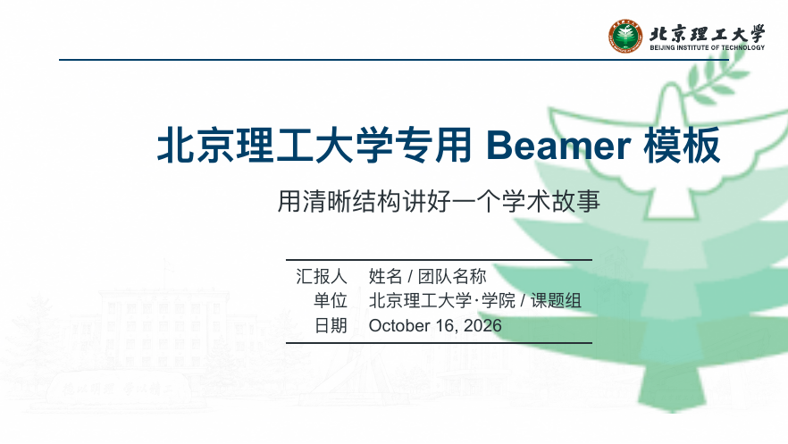

# 北京理工大学专用 Beamer Agent 模板｜Word 大纲 → 可编辑 LaTeX + PDF

> 把你自己的 Word 大纲交给主流 Agent，即可生成组会或预答辩使用的、可继续编辑的 LaTeX 源文件与 PDF。


本模板以北京理工大学蓝、红为主色，内置校徽、校园底纹、章节导航、封面、信息卡片、数据图、流程图、图文页与总结页。`main.tex` 本身就是一份可直接替换文字与图片的示例演示文稿。



## 快速开始

1. 克隆仓库并打开 `main.tex`。
2. 修改开头的 `\PresentationTitle`、`\PresentationSubtitle`、`\PresentationAuthor` 等元信息。
3. 在每一页将示例文字、数值、图片路径替换为你的内容。
4. 用 XeLaTeX 编译两次，或用 Tectonic 一键编译：

```bash
tectonic -X compile --outdir build main.tex
```

若使用 TeX Live / MacTeX：

```bash
xelatex -output-directory=build main.tex
xelatex -output-directory=build main.tex
```

## Word 大纲交给 Agent 的工作流

你不需要使用某一份固定的 Word 模板。只要大纲包含报告标题、听众与时长、章节结构、每页要传达的一句话、对应的证据/图片/数据来源，主流 Agent 就可以据此生成组会或预答辩版本。

1. 准备自己的 Word 大纲和项目素材（数据、图片、图表、参考文献）。
2. 将 Word 大纲、本仓库地址和素材一并提供给 Agent。
3. 要求 Agent 交付可编辑 `.tex`、所需 `assets/` 和已编译的 PDF；不要只交付 PDF。
4. 编译检查通过后，再根据导师或评审反馈让 Agent 继续修改 `.tex`。

可直接复制以下提示词：

```text
请阅读我提供的 Word 大纲，并以 https://github.com/hongyulyu714-prog/bit-beamer-template 为版式基础，生成一份用于[组会/预答辩]的中文 Beamer。

请先把每页标题改写为结论式标题，再将大纲内容写入 main.tex 或新建一个可编辑 .tex 文件。必须保留北京理工大学校徽、assets/bit_campus_background.jpeg 校园底纹、16:9 比例、侧栏导航和页脚风格；不得删除底纹。优先使用图表、流程图、对比表与图片呈现信息，每页只表达一个主要结论，并在页底标明数据、引用和图片出处。

完成后请用 XeLaTeX 或 Tectonic 编译，交付可编辑 LaTeX 源文件、所需 assets 和最终 PDF，并报告编译是否通过。
```

更完整的协作方式见 [Agent 编辑指南](AGENT_EDITING_GUIDE.md)。

## 目录

```text
.
├── assets/                 # 校徽、校园背景与装饰性图形
├── AGENT_EDITING_GUIDE.md  # 如何让 Agent 根据 Word 大纲编辑模板
├── main.tex                # 可编辑的完整模板与示例
├── LICENSE                 # MIT 许可（模板源代码）
└── README.md
```

## 使用建议

- 保持单页只传达一个结论；优先使用模板中的 `\MetricCard`、`\InsightBox`、`\PhotoCard` 等组件。
- 学术汇报中，请在图表页底部补充数据来源；示例数字仅用于展示排版，不代表真实统计结论。
- 模板中的校园底纹文件为 `assets/bit_campus_background.jpeg`；请保留它作为封面和内容页的视觉底纹。
- 使用校徽、校名、校园图片前，请确认你的具体使用场景符合北京理工大学的相关规范。

## 说明

这是一个由社区维护的非官方模板，并不代表北京理工大学的官方发布或立场。模板代码采用 MIT License；`assets/` 中随原始用户提供工程附带的校徽与校园图片仍应遵循其各自的权利与学校视觉规范。
